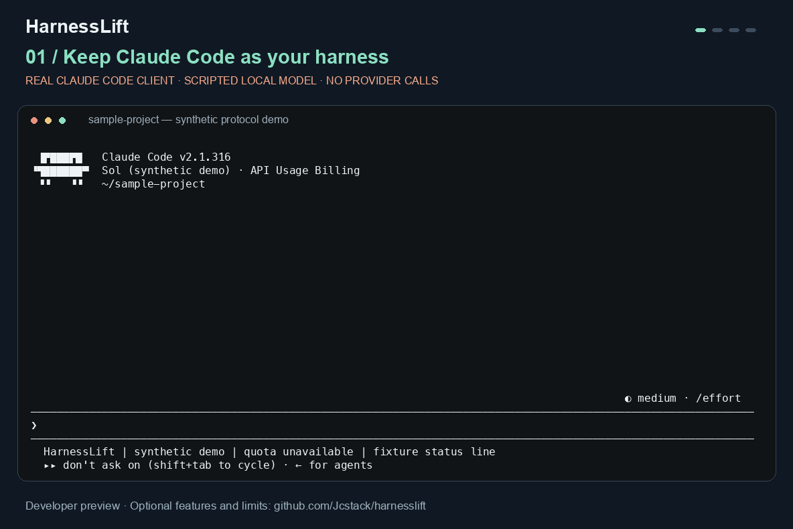

<p align="center">
  
</p>

<h1 align="center">HarnessLift</h1>

<p align="center"><strong>Run Claude Code with your Codex models.</strong></p>

<p align="center">Codex-backed OpenAI models as Claude Code's model provider, through a local HTTP bridge.</p>

<p align="center">
  <a href="https://github.com/Jcstack/harnesslift/actions/workflows/ci.yml"></a>
  <a href="https://github.com/Jcstack/harnesslift/releases"></a>
  <a href="LICENSE"></a>
</p>

Keep Claude Code as your coding harness: its terminal, local tools, permissions, MCP servers, skills, hooks, and subagents. HarnessLift translates model requests through a private local HTTP bridge to the Codex backend. Claude Code executes the work; Codex supplies the model.

**Developer preview.** This is a working integration with documented limits, including unresolved upstream stream interruptions. It does not establish feature parity with a native Claude model or reliable unattended recovery. Start with the [compatibility matrix](COMPATIBILITY.md) and [streaming status](STREAMING.md).

Previously `claude-codex-http-bridge`. The `claude-codex` command remains compatible; existing installation directories, accounts, environment settings, and service identities keep their names.

<p align="center">
  
</p>

*The walkthrough uses the real Claude Code client and a scripted local model. It makes no provider calls and shows no real account, quota, prompt, or performance measurement. [Recording details](assets/README.md).*

[Try the preview](#quick-start) · [Check compatibility](COMPATIBILITY.md) · [Share first-run feedback](https://github.com/Jcstack/harnesslift/issues/new?template=trial_feedback.yml)

## Why HarnessLift?

- **Claude Code stays in charge.** Use the harness you already know, with local tool permissions and project configuration.
- **Choose models inside the session.** `/model` uses the discovered eligible catalog; `/effort` follows advertised capabilities. Catalog metadata is not proof of account entitlement.
- **Keep the bridge on your machine.** Loopback binding, private local credentials, verified proxy downloads, and source-only Git rules. Model requests still go to OpenAI.
- **Bring more capabilities when you need them.** Optional native tools, scoped desktop access, HUD metadata, and reviewed runtime extensions each have their own setup and limits.
- **Use macOS, Linux, or Windows.** The installer and credential-free checks cover all three; actual Windows account/login and reboot behavior still need live validation.

```text
Claude Code  →  private local HTTP bridge  →  Codex / OpenAI
    │              Anthropic → Responses        model inference
    └─ local tools, permissions, MCP, skills, hooks, subagents
```

## Quick start

You need [Claude Code](https://code.claude.com/docs/en/setup) on `PATH`, Python 3.10+, and a ChatGPT account with Codex access. macOS/Linux also need `bash` and `lsof`; Windows requires Windows 10 1809+ / Server 2019+ and NTFS. [Full requirements](USAGE.md#requirements).

### macOS / Linux / WSL

```bash
git clone https://github.com/Jcstack/harnesslift.git
cd harnesslift
./install.sh
# Ensure ~/.local/bin is on your PATH, then:
harnesslift codex-login
harnesslift models
harnesslift
```

### Windows PowerShell

```powershell
git clone https://github.com/Jcstack/harnesslift.git
cd harnesslift
py -3 .\install.py
# Open a new terminal for the user PATH change, then:
harnesslift codex-login
harnesslift models
harnesslift
```

Inside Claude Code, use `/model` to choose a model and `/effort` to choose an offered effort. To select a model at launch, run `harnesslift --model MODEL_ID` with an ID from `harnesslift models`. The default follows the launcher's supported Sol-family preference; new model availability also depends on upstream registry and capability support. [Model selection and subagents](USAGE.md#quick-start).

The installer verifies a pinned [CLIProxyAPI](https://github.com/router-for-me/CLIProxyAPI) release and installs **both** `harnesslift` and `claude-codex`. It refuses unrelated command conflicts before installation writes. The original `claude` command keeps its own settings. OAuth happens in your browser; credentials stay in the private local installation.

**Already running the old version?** Keep using `claude-codex`. This rebrand does not require a session restart or account migration. Install source updates only after dependent sessions and background tasks finish: controller installation is not an atomic live update. [Upgrade boundaries](USAGE.md#install).

## What is available?

| Area | Current scope | Details |
| --- | --- | --- |
| Local Claude Code workflow | Model selection, tool use, permissions, MCP, hooks, skills, subagents, resume; behavior tested with specific client versions | [Compatibility](COMPATIBILITY.md) |
| Models, effort, context | Generated from eligible catalog metadata; no promise that every registered model is entitled or that every provider effort maps to Claude UI | [Usage](USAGE.md#use) |
| Web search and citations | Native search preservation and citation replay require the reviewed runtime | [Runtime](RUNTIME.md) |
| Prompt caching and HUD | Provider-reported cache counters, context and usage adaptation; cache hits and subscription cost are not fabricated | [Cache audit](CACHE_AUDIT.md), [HUD](USAGE.md#claude-hud-and-other-status-line-plugins) |
| Images, PDFs, audio | Optional native capability package via MCP; Python 3.11+ and explicit setup | [Native tools](NATIVE_TOOLS.md) |
| Computer use and browser | Separately authorized window scope and opt-in browser integration | [Desktop](NATIVE_TOOLS.md), [Browser](BROWSER.md) |
| Native Codex compaction | Opt-in; requires the reviewed V2 runtime, with documented continuation limits | [Compaction](NATIVE_COMPACTION.md) |
| Accounts and recovery | Staged local account selection, quota checks, managed service recovery; in-flight requests and atomic publication have limits | [Accounts](ACCOUNTS.md), [Operations](OPERATIONS.md) |
| Direct OpenAI API key | Separate pilot route with project billing; live validation remains outstanding | [API route](API_ROUTE_RESEARCH.md) |

The fresh installer downloads the pinned upstream proxy. Runtime extensions and optional packages are separate steps; cloning this repository does not activate every capability in the table. Provider-hosted Claude features such as Remote Control have their own account requirements. See the [capability audit](CAPABILITY_AUDIT.md) for boundaries and evidence.

## Useful commands

```text
harnesslift --help                  Show bridge commands and launch options
harnesslift models                  Inspect eligible catalog metadata
harnesslift usage                   Read subscription usage when available
harnesslift bridge status           Inspect the private local service
harnesslift account list            List staged local accounts
harnesslift --resume SESSION_ID     Resume using current route settings
harnesslift tools status            Inspect optional native capabilities
```

The local service stays available for background work. `harnesslift bridge stop` disconnects remaining requests; use it after dependent tasks finish. [Full usage guide](USAGE.md).

## First-run feedback

Try a small task in a disposable project with normal Claude Code permissions. Useful checks are startup, `/model`, one local tool call, and resuming the conversation. A successful check covers that configuration; it does not establish support for every command or plugin. Provider requests use your own account's available quota.

[Tell us what worked or blocked you](https://github.com/Jcstack/harnesslift/issues/new?template=trial_feedback.yml), even if everything worked. The short form asks for your platform, versions, and outcome. Keep credentials, account identifiers, private paths, prompts, and logs out of public feedback.

## Common questions

**Can I use Codex models as Claude Code's backend?** Yes. HarnessLift supplies the model route through a local HTTP bridge. Claude Code remains responsible for the local workflow and tool permissions.

**Which model is answering?** The provider is Codex/OpenAI. Model behavior and quality can differ from Claude; this integration does not establish Opus equivalence. Use the eligible catalog and [compatibility matrix](COMPATIBILITY.md) to check the current scope.

**How does this compare with a Codex MCP agent?** This project routes Claude Code's model requests to Codex-backed inference. It does not launch a separate Codex coding agent to carry out delegated tasks.

**Does a local bridge keep inference offline?** Model requests and relevant context still reach OpenAI. Local credential storage and loopback binding do not isolate other programs running as your user. [Security boundaries](SECURITY.md).

## Security and privacy

The bridge binds to loopback, requires a random local key, and keeps OAuth/config/runtime data in private directories with POSIX permissions or Windows ACLs. The installer verifies the pinned proxy checksum. Request/debug logs and the proxy management panel are disabled by default.

This is a local bridge to a cloud model, so prompts and relevant tool results reach OpenAI. Claude Code, plugins, and configured MCP servers have their own storage and network behavior. This repository excludes runtime data and credentials through an explicit source allowlist. See [security boundaries and reporting](SECURITY.md), and never paste tokens, raw transcripts, or unredacted logs into public issues.

## Project documentation

| Start here | Go deeper |
| --- | --- |
| [Usage and installation](USAGE.md) | [Runtime and reviewed patches](RUNTIME.md) |
| [Compatibility matrix](COMPATIBILITY.md) | [Model versus harness evidence](MODEL_HARNESS_EVIDENCE.md) |
| [Troubleshooting and operations](OPERATIONS.md) | [Streaming investigation](STREAMING.md) |
| [Current plan](PLAN.md) | [Community review](COMMUNITY_REVIEW.md) |
| [Contributing](CONTRIBUTING.md) | [Changelog](CHANGELOG.md) |

## Credits and license

HarnessLift's wrapper and installer are MIT licensed. The proxy is built on [CLIProxyAPI](https://github.com/router-for-me/CLIProxyAPI), downloaded separately under its own MIT license; reviewed extensions are attributed in the runtime documentation. Claude Code is provided separately by Anthropic, and Codex/OpenAI models are provided by OpenAI. HarnessLift is an independent community project.
